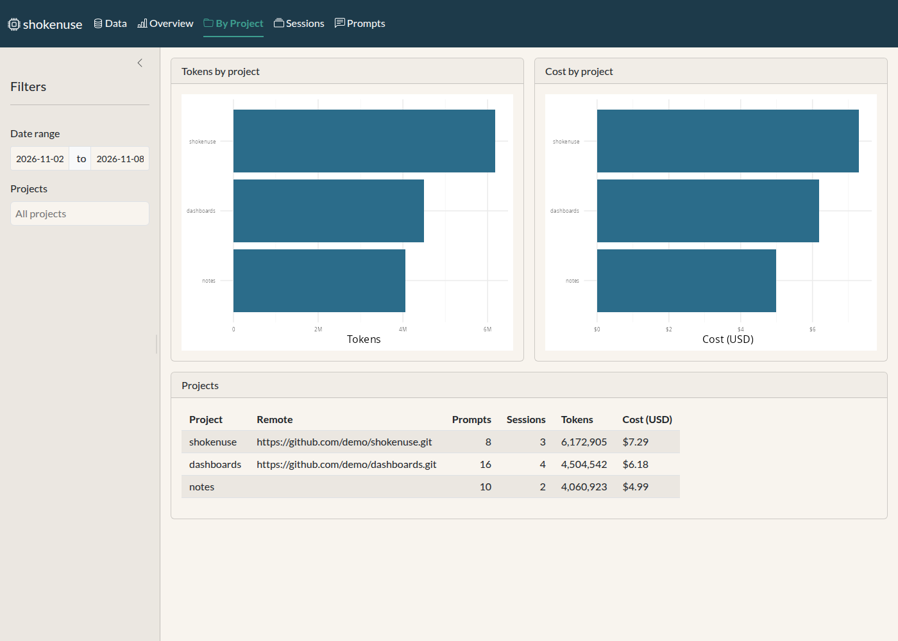

```{r}
#| label: setup
#| include: false
library(shokenuse)
```

The By Project tab compares projects. A project is the git repository of the working directory, or the folder name outside a repository.

The screenshot below shows the tab with the example data that ships with the package.

{fig-alt="By Project tab: bar charts of tokens and cost by project, above a table of projects with remotes, prompts, sessions, tokens, and cost."}

## Charts and table

| Output | What it shows |
|---|---|
| Tokens by project | Top 20 projects by total tokens. |
| Cost by project | Top 20 projects by total cost. |
| Projects table | Every project with its git remote, prompts, sessions, tokens, and cost. |

The code below builds the summary behind the tab and draws the cost chart:

```{r}
#| label: project
metrics <- util_read_token_metrics()
by_project <- util_summarise_metrics(metrics, by = c("project", "url"))
util_plot_rank(by_project, "project", "cost")
```

## Call stack

`mod_project_server()` summarises the filtered data once and draws both rank charts from that summary. The call tree below is built with [`stackcallr`](https://mjfrigaard.github.io/stackcallr/). `call_tree_dir()` parses the files in `R/` without running them, so the tree always matches the code.

```{r}
#| label: call-stack-by-project
#| eval: !expr requireNamespace("stackcallr", quietly = TRUE)
#| collapse: false
#| comment: ""
stackcallr::call_tree_dir("../R", root = "mod_project_server")
```
