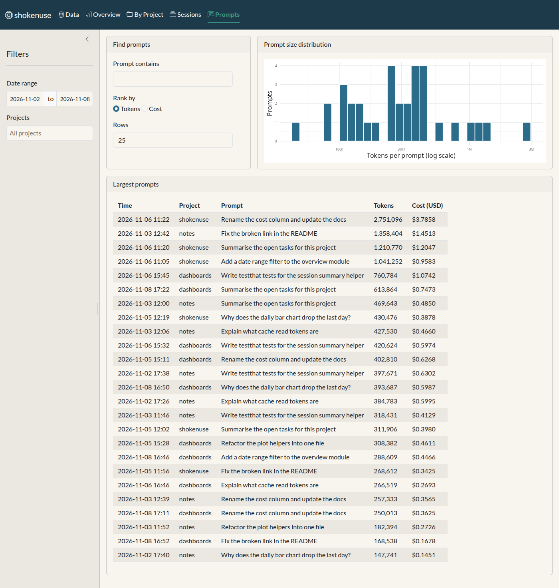

```{r}
#| label: setup
#| include: false
library(shokenuse)
```

The Prompts tab finds the prompts that used the most tokens or cost the most.

The screenshot below shows the tab with the example data that ships with the package.

{fig-alt="Prompts tab: search box, rank and rows inputs, a histogram of tokens per prompt on a log scale, and a table of the largest prompts."}

## Searching and ranking

| Input | Description |
|---|---|
| Prompt contains | Keeps prompts containing this text (case insensitive). |
| Rank by | Tokens or cost. |
| Rows | Number of prompts in the table. |

## Chart and table

The histogram shows tokens or cost per prompt on a log scale. The table lists the largest prompts with their time, project, text, tokens, and cost.

A prompt's tokens include every model call made while answering it, subagents included. A short prompt that starts a long task can therefore be the largest.

The code below draws the histogram and lists the 10 most expensive prompts:

```{r}
#| label: prompts
metrics <- util_read_token_metrics()
util_plot_prompts(metrics, "tokens")
dplyr::slice_max(metrics, cost, n = 10)
```

## Call stack

`mod_prompts_server()` draws the ranking chart and formats the largest prompts table. The call tree below is built with [`stackcallr`](https://mjfrigaard.github.io/stackcallr/). `call_tree_dir()` parses the files in `R/` without running them, so the tree always matches the code.

```{r}
#| label: call-stack-prompts
#| eval: !expr requireNamespace("stackcallr", quietly = TRUE)
#| collapse: false
#| comment: ""
stackcallr::call_tree_dir("../R", root = "mod_prompts_server", exclude = "%||%")
```
