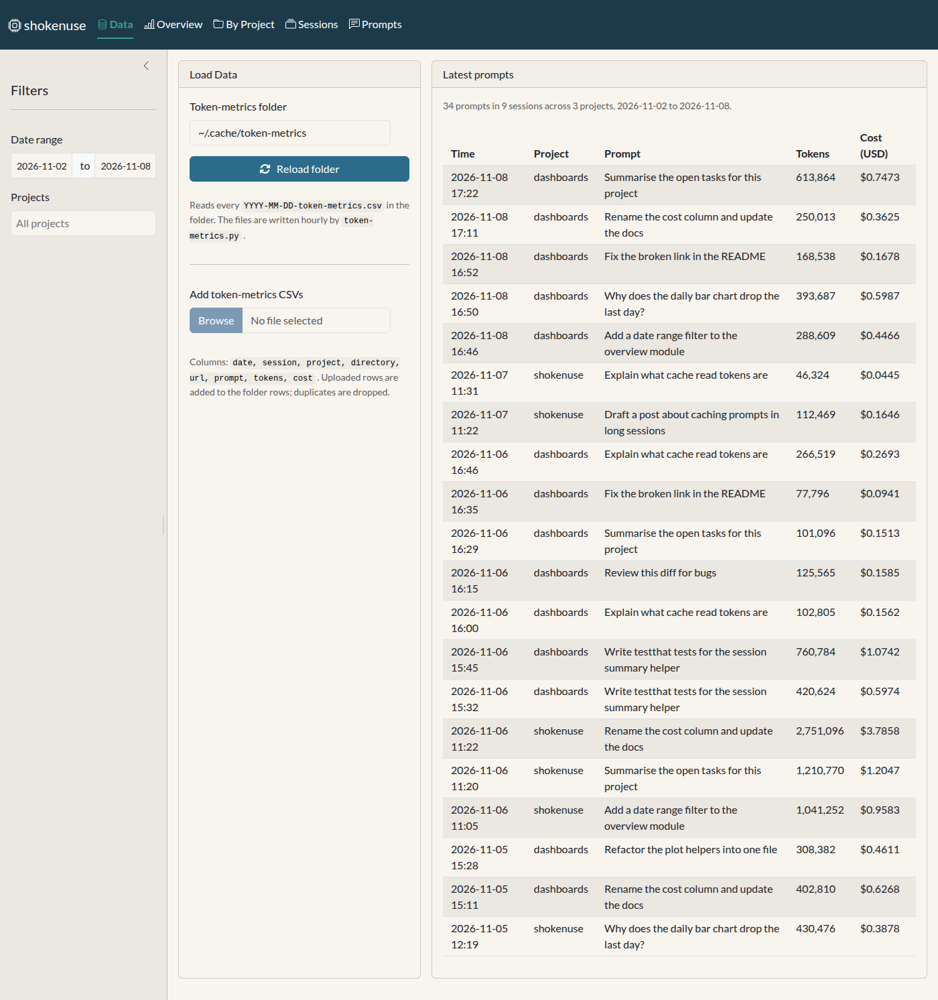

```{r}
#| label: setup
#| include: false
library(shokenuse)
```

shokenuse only works if `token-metrics.py` runs every hour. Today that takes several manual steps on each machine: copy the script, write a launchd agent or systemd timer, and keep the CSVs out of any cleanup routine. This article plans how a desktop installer and a setup screen inside the app will replace those steps. The installer is a `.dmg` on macOS and a Linux package on Pop!_OS.

Nothing described here is built yet unless it says so. The manual steps that work today are at the end.

## What the installer sets up

The installer puts three things on the machine: the app, the script, and a schedule that runs the script. A setup screen in the app connects them the first time it opens.

```{mermaid}
%%| eval: true
%%| fig-height: 8
%%| fig-cap: 'Planned install and first run'
%%{init: {'theme': 'base', 'themeVariables': { 'fontFamily': 'monospace', 'fontSize':'16px', 'darkMode':false}}}%%

flowchart TD
    inst(["<strong>Installer</strong><br/>.dmg or Linux package"]) --> app(["<strong>shokenuse app</strong>"])
    app --> setup
    subgraph setup["<strong>Setup screen</strong> (first run)"]
        s1("i. Check python3 and transcripts")
        s2("ii. Copy the script")
        s3("iii. Schedule the script")
        s4("iv. Transcript retention")
        s5("v. Session duration")
        s1 --> s2 --> s3 --> s4 --> s5
    end
    s3 -.-> sched(["<strong>launchd</strong> or <strong>systemd</strong><br/>hourly"])
    sched -.-> py("<code>token-metrics.py</code>")
    s4 -.-> cfg[("<code>~/.claude/settings.json</code><br/>cleanupPeriodDays")]
    py --> csv[("<code>~/.cache/token-metrics/</code><br/>YYYY-MM-DD-token-metrics.csv")]
    csv --> app

    style setup fill:#FFFFFF,color:#000000,stroke:#333,stroke-width:1px,rx:10,ry:10
    style s1 fill:#4CBB9D,color:#FFFFFF,rx:5,ry:5
    style s2 fill:#4CBB9D,color:#FFFFFF,rx:5,ry:5
    style s3 fill:#4CBB9D,color:#FFFFFF,rx:5,ry:5
    style s4 fill:#4CBB9D,color:#FFFFFF,rx:5,ry:5
    style s5 fill:#4CBB9D,color:#FFFFFF,rx:5,ry:5
```

The sections below follow the diagram: the script first, then the schedule, the setup screen, and the build.

## One script for both machines

The script exists today as two separate copies, one per machine, and they have drifted apart:

| | macOS copy | Pop!_OS copy |
|---|---|---|
| Files written | One file per day, holding that day's prompts | Today's file, holding the full history |
| Days rewritten | Last 7 days; older days only if their file is missing (`--all` rewrites every day) | All history, every run |
| `date` column | Local date and time | Local date only |
| Write method | `.tmp` file, then rename | Writes the file in place |
| Prices | `RATES`, with long context and fast mode rules | `PRICES`, base rates only |
| Flags | `--all` | `--show-cleanup-days`, `--set-cleanup-days N` |
| Scheduler | launchd, hourly and at login | systemd timer, hourly |

The package will ship one merged script in `inst/scripts/token-metrics.py`. The plan is to keep the macOS file layout and add the Pop!_OS flags:

* One file per day, written through a `.tmp` file and renamed, so the app never reads a half written file.
* Each run rewrites the last 7 days. Older days are written only when their file is missing, and `--all` rewrites every day the transcripts still cover.
* The `date` column holds the local date and time.
* The `RATES` table, with the long context and fast mode rules, is the only price table.
* `--show-cleanup-days` and `--set-cleanup-days N` print or set `cleanupPeriodDays`, then run the report as usual.

### Why one file per day

The per day layout matters for history. The Pop!_OS layout writes the same prompts into a new file every day, and a prompt's token count can grow between runs. The app drops rows that are exact duplicates. Two copies of one prompt with different token counts are not exact duplicates, so both would be counted. One file per day gives each prompt exactly one row.

The script still uses only the Python standard library, so the system `python3` is enough on both machines.

## Scheduling the script

The schedule has to point at a copy of the script that stays put. The installed package path changes every time the package is upgraded, so setup copies the script to a stable data folder first:

```{r}
#| label: script-path
#| code-fold: false
script_dir <- tools::R_user_dir("shokenuse", which = "data")
# macOS:   ~/Library/Application Support/org.R-project.R/R/shokenuse
# Pop!_OS: ~/.local/share/R/shokenuse
dir.create(script_dir, recursive = TRUE, showWarnings = FALSE)
file.copy(system.file("scripts", "token-metrics.py", package = "shokenuse"),
          script_dir, overwrite = TRUE)
```

Setup then writes the scheduler files from templates in the package. Two values are filled in: `{python3}`, the interpreter found in step i, and `{script_dir}`, the folder above.

### macOS

A launchd agent at `~/Library/LaunchAgents/shokenuse.token-metrics.plist` runs the script every hour and at login:

```xml
<key>Label</key>
<string>shokenuse.token-metrics</string>
<key>ProgramArguments</key>
<array>
  <string>{python3}</string>
  <string>{script_dir}/token-metrics.py</string>
</array>
<key>StartInterval</key>
<integer>3600</integer>
<key>RunAtLoad</key>
<true/>
```

Setup loads the agent with `launchctl bootstrap gui/$(id -u) <plist>`, and the Settings tab can unload it with `launchctl bootout`.

### Pop!_OS

A systemd user timer does the same job with two unit files in `~/.config/systemd/user/`:

```ini
# token-metrics.service
[Unit]
Description=Claude Code token and cost report

[Service]
Type=oneshot
ExecStart={python3} -I {script_dir}/token-metrics.py
```

```ini
# token-metrics.timer
[Unit]
Description=Run token-metrics hourly

[Timer]
OnCalendar=hourly
Persistent=true

[Install]
WantedBy=timers.target
```

`Persistent=true` matters on a laptop: if the machine was asleep or off when a run was due, systemd runs it at the next wake. Setup enables the timer with `systemctl --user enable --now token-metrics.timer`, and the Settings tab can disable it the same way.

## The setup screen

The setup screen opens the first time the app starts. It can be reopened later from a Settings tab, so every choice on it can be changed without reinstalling. Each step reports what it found before it changes anything.

### i. Check python3 and transcripts

Setup looks for `python3` on the `PATH` and for transcripts in `~/.claude/projects/`. If either is missing, the screen says which one and stops there, because the remaining steps depend on both.

### ii. Copy the script

Setup copies the bundled script to the data folder shown above and runs it once. The screen shows how many daily CSVs the first run wrote, which confirms the script works on this machine before anything is scheduled.

### iii. Schedule the script

A single switch turns the hourly schedule on or off. On macOS it writes and loads the launchd agent; on Pop!_OS it writes and enables the systemd timer. The screen shows the time of the next run, read back from `launchctl print` or `systemctl --user list-timers`.

### iv. Transcript retention

Claude Code deletes transcripts older than `cleanupPeriodDays`, a setting in `~/.claude/settings.json`. When the setting is missing, the limit is 30 days. Once a transcript is deleted, the script can no longer count its prompts, so the CSVs already written become the only record of that history.

The screen shows a number input for `cleanupPeriodDays` with these rules:

* It starts at the current value, or 30 when the setting is missing.
* A note under the input explains that the dashboard reads the CSVs, so a longer limit only matters if you want the transcripts themselves kept.
* It accepts any whole number of 1 or more.
* Saving writes `settings.json` only when the value differs from the current one. The write replaces only that key, so every other setting is preserved. It goes through a temporary file and a rename.
* The app writes the file itself rather than calling the script, so the setting can change without starting a report.

The screen also states one rule that setup cannot enforce: any cleanup script that removes stale files from `~/.cache` should skip `~/.cache/token-metrics/`.

### v. Session duration

The Sessions tab reports how long each session lasted, and the right measure depends on how you work. Setup offers two:

* Span: minutes from the first prompt to the last. This is the current measure. A session resumed days later shows a span of days.
* Active time: the sum of the gaps between prompts that are shorter than a cutoff (30 minutes by default). Longer gaps count as breaks.

The choice and the cutoff are saved in the app's config folder, `tools::R_user_dir("shokenuse", which = "config")`, and the Sessions tab reads them at startup. `util_summarise_sessions()` will take the same two settings as arguments, so the measure can be used outside the app.

## Building the installers

The installers will be built with [shinyelectron](https://r-pkg.thecoatlessprofessor.com/shinyelectron/), which wraps a Shiny app in an Electron desktop app. shinyelectron needs an exported function that returns a `shiny.appobj`, and `launch_app()` already does.

The runtime strategy is `system`, which runs the app with the R already installed on the machine:

* The app has to read `~/.cache` and `~/.claude` and write `settings.json`, launchd agents, and systemd units. A browser based runtime such as shinylive cannot reach the file system.
* shinyelectron does not support its bundled or downloaded R runtimes for Linux targets.
* Both machines already have R, so requiring it costs nothing here.

A GitHub Actions workflow builds each installer on its own operating system, because macOS installers only build on macOS. It installs shokenuse from the checkout and attaches the installers to a release.

## Open questions

These decisions are still open:

* Linux package format: shinyelectron documents `.AppImage` builds. Whether it can produce a `.deb` directly, or the `.deb` needs a separate packaging step, has not been checked.
* Merged script output: the per day layout above is the proposal, and it should be confirmed before the two copies are merged.
* Uninstall: whether removing the app should also unload the schedule, or leave that to the Settings tab.

## Setting it up by hand today

Until the installers exist, these steps reproduce the setup on either machine.

Install the package:

```{r}
#| label: install
#| code-fold: false
pak::pak("mjfrigaard/shokenuse")
```

Save a copy of the script in a stable location (the examples use `/path/to/token-metrics.py`) and run it once. If a dated CSV appears in `~/.cache/token-metrics/`, it works:

```{bash}
#| eval: false
#| code-fold: false
#| echo: true
python3 /path/to/token-metrics.py
```

Schedule it with the launchd agent or the systemd units shown above, using the output of `command -v python3` for `{python3}` and `/path/to/token-metrics.py` for `{script_dir}/token-metrics.py`. On Pop!_OS, reload the units and confirm the next run:

```{bash}
#| eval: false
#| code-fold: false
#| echo: true
systemctl --user daemon-reload
systemctl --user enable --now token-metrics.timer
systemctl --user list-timers token-metrics.timer
```

Then launch the app:

```{r}
#| label: launch
#| code-fold: false
library(shokenuse)
launch_app()    # reads ~/.cache/token-metrics
```

The Data tab confirms what loaded. The summary above the table counts prompts, sessions, and projects, and gives the date range:

{fig-alt="Data tab: folder path, Reload folder button, CSV upload, and a table of the latest prompts with time, project, prompt, tokens, and cost."}

## Recap

The installed app will own the whole setup. It ships one script for both machines, copies it to a stable folder, and schedules it with launchd or systemd. A setup screen you can reopen at any time sets `cleanupPeriodDays` and the session duration measure. The per day CSV layout keeps one row per prompt. Keeping `~/.cache/token-metrics/` out of cleanup routines preserves the history that Claude Code's transcripts lose after 30 days.
